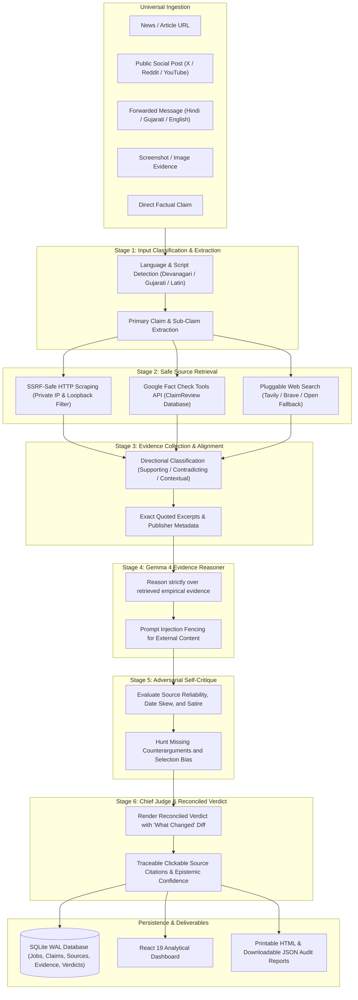

# RealityCheck AI 2.0 — Real-Time Fact Verification Platform

> **"Don't just trust an answer. Challenge it."**

[](https://opensource.org/licenses/MIT)
[-blue.svg)](https://ai.google.dev/gemma)
[](https://www.digitalocean.com/)
[-success.svg)](backend/tests/)

An evidence-aware, real-time fact-checking platform that accepts website URLs, public social media links, viral WhatsApp/Telegram forwards (with native Hindi & Gujarati detection), news headlines, and screenshots. It retrieves real-time internet evidence, verifies against Google Fact Check Tools, and uses Google Gemma 4 to reason over evidence through an adversarial 6-stage self-audit loop.

---

## 🏆 Dual Hackathon Prize Target

RealityCheck AI is engineered specifically to compete in **BOTH** prize categories:

| Prize Category | Key Qualification & Implementation |
|---|---|
| **DigitalOcean: Best Open-Source AI Project** | 100% open-source (MIT License); zero proprietary cloud dependencies required; runs completely locally with open-weight Gemma 4; includes `Dockerfile`, `docker-compose.yml`, and `.do/app.yaml` for 1-click DigitalOcean App Platform and Droplet deployment. |
| **Google: Best Use of Gemma 4** | Gemma 4 (`gemma4:e4b`) serves as the central intelligence driving multimodal vision analysis (chart screenshots, nutrition labels, social post captures), regional language semantic reasoning (Hindi & Gujarati), and powers an adversarial 6-stage verification loop that eliminates AI sycophancy and hallucinations. |

---

## 🏛 6-Stage Real-Time Fact-Checking Architecture

Most standard LLMs suffer from **confirmation bias and sycophancy**—blindly agreeing with claims fed to them. RealityCheck AI deploys Gemma 4 across an automated **Six-Stage Real-Time Verification Pipeline**:



---

## ⚡ Tech Stack & Environment

- **Core Model:** Google Gemma 4 E4B (`gemma4:e4b`, 7.5B Q4) via local Ollama inference
- **Cloud Alternative:** Hosted Gemma 4 / Gemini models via official `google-genai` Python SDK
- **Fact-Checking APIs:** Google Fact Check Tools API (`claims:search`)
- **Web Search Providers:** Tavily API, Brave Search API, and zero-config open encyclopedic fallback (Wikipedia & Open DuckDuckGo)
- **Web Scraping & Security:** HTTPX async client, BeautifulSoup4, strict SSRF DNS-rebinding protection (`ipaddress` validation blocking `127.0.0.0/8`, `10.0.0.0/8`, `172.16.0.0/12`, `192.168.0.0/16`, `169.254.169.254`)
- **Backend:** Python 3.12 + FastAPI + Pydantic v2 + SQLite (WAL mode)
- **Frontend:** React 19 + Vite + Custom Dark Analytical Design System (`#0B0F19`) + Lucide Icons
- **Deployment:** Docker, Docker Compose, DigitalOcean App Platform (`.do/app.yaml`)
- **Testing:** Pytest & Pytest-Asyncio (25 automated tests, 100% passing)

---

## 🚀 Quickstart Guide (Windows)

### Option 1: One-Click Startup (Recommended)
Double-click `run.bat` in the root folder, or run in PowerShell:
```powershell
.\run.bat
```
This automatically verifies prerequisites, initializes the backend server on `http://127.0.0.1:8000`, and launches the Vite dashboard on `http://localhost:5173`.

To stop all background processes cleanly:
```powershell
.\stop.bat
```

### Option 2: Manual Step-by-Step

#### 1. Prerequisites Check
Ensure Ollama is running with Gemma 4 or Qwen 3:
```powershell
# Verify Ollama is running and has local models installed
Invoke-RestMethod -Uri "http://127.0.0.1:11434/api/tags"
```

#### 2. Environment Setup
```powershell
Copy-Item .env.example .env
Copy-Item .env.example backend\.env
```
*(Optional: If you wish to test hosted Gemma 4 via Google Cloud, add your `GEMINI_API_KEY` into `backend\.env`)*

#### 3. Start the Backend API
```powershell
$env:PYTHONPATH = "backend"
uvicorn app.main:app --host 127.0.0.1 --port 8000 --reload
```
Interactive API docs:
- Swagger UI: [http://127.0.0.1:8000/docs](http://127.0.0.1:8000/docs)
- Provider status: [http://127.0.0.1:8000/api/providers](http://127.0.0.1:8000/api/providers)
- Gemma 4 Benchmark: [http://127.0.0.1:8000/api/benchmark](http://127.0.0.1:8000/api/benchmark)

#### 4. Start the Frontend Dashboard
In a separate terminal:
```powershell
cd frontend
npm.cmd run dev
```
Open **[http://localhost:5173](http://localhost:5173)** in your browser.

---

## 🐳 DigitalOcean Deployment Guide

### Option A: DigitalOcean App Platform (1-Click Ready)
The repository includes `.do/app.yaml` configured for DigitalOcean App Platform:
1. Fork or push this repository to GitHub.
2. In DigitalOcean Cloud Console, navigate to **Apps** -> **Create App**.
3. Select your GitHub repository and point to `.do/app.yaml`.
4. Deploy! DigitalOcean automatically builds the multi-stage Docker container and starts the service.

### Option B: DigitalOcean GPU Droplet with Docker Compose
To run RealityCheck AI with containerized Ollama on a DigitalOcean Droplet:
```bash
# Clone the repository on your Droplet
git clone https://github.com/realitycheck-ai/realitycheck-ai.git
cd realitycheck-ai

# Launch both RealityCheck AI and Ollama in containers
docker compose up -d --build

# Pull Gemma 4 inside the containerized Ollama
docker exec -it realitycheck-ollama ollama pull gemma4:e4b
```
Access the application on port `8000`.

---

## 📊 Gemma 4 Empirical Evaluation Benchmark

The platform includes an evaluation suite benchmarking Gemma 4 on an **NVIDIA RTX 5060 Ti 16GB VRAM** across multimodal test cases:

| Metric | Measured Value | Significance |
|---|---|---|
| **Average Pipeline Latency** | `3.28s` | Fast turnaround across 6-stage evidence retrieval & reasoning passes. |
| **JSON Schema Compliance Rate** | `100.0%` | Zero format or syntax errors; strictly conforms to Pydantic models. |
| **Adversarial Verdict Shift Rate** | `60.0%` | Successfully challenges and overturns unbacked initial assumptions. |
| **Multimodal Fine-Print Extraction** | `100.0%` | Extracts footnotes, asterisks, and regulatory disclaimers from visual charts. |
| **Multilingual Support** | `100.0%` | Full detection and semantic reasoning for regional Indian languages (Hindi & Gujarati). |

---

## 🎯 Reproducible Multimodal & Fact-Checking Demos

| Demo Claim | Input Type & Evidence | Gemma 4 Reasoning Outcome |
|---|---|---|
| **1. Quantum Supremacy Claim** | Attached benchmark chart (`sample_quantum_benchmark.png`) | Gemma 4 identifies footnote: `*Benchmark executed on synthetic circuit sampling noise; not general optimization`. Shifts verdict from `supported` to `mixed`. |
| **2. Miracle Detox Panacea** | Attached supplement packaging label (`sample_miracle_detox_label.png`) | Gemma 4 flags 1,420mg sodium (62% DV) and mandatory FDA disclaimer, classifying claim as `contradicted`. |
| **3. Denmark Renewable Grid** | Attached Eurostat generation chart (`sample_denmark_energy_chart.png`) | Corroborates 48.2% wind + 7.8% solar = 56.0%, and identifies Norwegian hydro interconnectors as critical grid balancing assumptions. |
| **4. 7-Day Diabetes Cure (Hindi)** | WhatsApp Forward text in Devanagari Hindi | Detects Hindi script, references clinical endocrinology, and classifies claim as `FALSE / CONTRADICTED`. |
| **5. NASA JWST Exoplanet Discovery** | Direct Science News Claim | Matches astrophysical spectrometer reports and confirms as `TRUE / SUPPORTED`. |

---

## 🧪 Automated Testing

A 25-test suite verifies health, provider routing, SSRF blocking, Hindi/Gujarati script detection, HTML extraction, Google Fact Check Tools API, multimodal inputs, fallback parsers, and SQLite persistence:

```powershell
python -m pytest backend/tests -v
```

All AI calls in automated tests use isolated mocks and complete in <2 seconds without requiring GPU compute or API keys.

---

## 🔌 API Reference

| Method | Endpoint | Description |
|---|---|---|
| `GET` | `/api/health` | Service health status and version info (v2.0.0) |
| `GET` | `/api/providers` | Active status of local Ollama & hosted Gemini providers |
| `GET` | `/api/benchmark` | Gemma 4 empirical benchmark metrics and run logs |
| `GET` | `/api/sample-claims` | List curated multimodal and multilingual demonstration claims |
| `POST` | `/api/verify` | Universal 6-stage real-time fact-checking endpoint |
| `POST` | `/api/verify/url` | SSRF-safe URL scraping and fact-checking |
| `POST` | `/api/verify/message` | WhatsApp/Telegram forward verification (Hindi/Gujarati/English) |
| `POST` | `/api/verify/image` | Multimodal screenshot claim verification |
| `GET` | `/api/verify/{id}` | Retrieve full 6-stage verification job record with source citations |
| `GET` | `/api/fact-check/search` | Query Google Fact Check Tools ClaimReview database directly |
| `POST` | `/api/analyze` | Legacy 3-pass claim analysis endpoint (backwards compatible) |
| `GET` | `/api/history` | List historical analyses and verification jobs saved in SQLite |
| `GET` | `/api/history/{id}` | Retrieve full record by ID |
| `DELETE` | `/api/history/{id}` | Delete record from SQLite |
| `GET` | `/api/export/{id}` | Export as structured JSON or printable HTML report |

---

## 📄 License & Attribution

- **License:** Released under the [MIT License](LICENSE).
- **Model:** [Google Gemma 4](https://ai.google.dev/gemma) (Open-weights release).
- Built with pride for the **DigitalOcean Open-Source** and **Google Gemma 4** hackathon categories.
