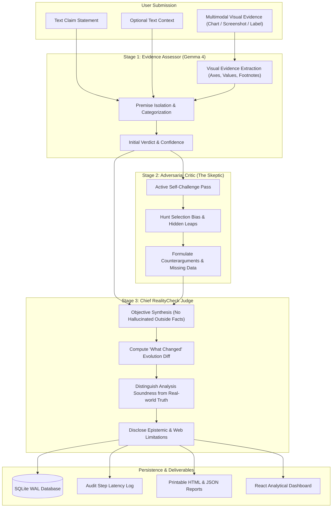

# RealityCheck AI

> **"Don't just trust an answer. Challenge it."**

[](https://opensource.org/licenses/MIT)
[-blue.svg)](https://ai.google.dev/gemma)
[](https://www.digitalocean.com/)
[-success.svg)](backend/tests/)

An evidence-aware AI claim analysis platform that separates supplied evidence, assumptions, counterarguments, unknowns, and model limitations through an active, multi-stage self-audit pipeline.

---

## 🏆 Dual Hackathon Prize Target

RealityCheck AI is engineered specifically to compete in **BOTH** prize categories:

| Prize Category | Key Qualification & Implementation |
|---|---|
| **DigitalOcean: Best Open-Source AI Project** | 100% open-source (MIT License); zero proprietary cloud dependencies; runs completely locally with open-weight Gemma 4; includes `Dockerfile`, `docker-compose.yml`, and `.do/app.yaml` for 1-click DigitalOcean App Platform and Droplet deployment. |
| **Google: Best Use of Gemma 4** | Gemma 4 (`gemma4:e4b`) serves as the core intelligence driving multimodal vision analysis (chart screenshots, nutrition labels, footnote asterisks) and powers a 3-pass adversarial self-critique loop that eliminates AI sycophancy. |

---

## 🏛 Epistemic Architecture & Multimodal Pipeline

Most standard LLMs suffer from **confirmation bias**—sycophantically agreeing with whatever claim a user feeds them. RealityCheck AI deploys Gemma 4 across a **Three-Stage Adversarial Pipeline**:



---

## ⚡ Tech Stack & Environment

- **Core Model:** Google Gemma 4 E4B (`gemma4:e4b`, 7.5B Q4) via local Ollama inference
- **Cloud Alternative:** Hosted Gemma 4 / Gemini models via official `google-genai` Python SDK
- **Backend:** Python 3.12 + FastAPI + Pydantic v2 + SQLite (WAL mode)
- **Frontend:** React 19 + Vite + Custom Dark Analytical Design System (`#0B0F19`) + Lucide Icons
- **Deployment:** Docker, Docker Compose, DigitalOcean App Platform (`.do/app.yaml`)
- **Testing:** Pytest & Pytest-Asyncio (17 automated tests, fully isolated)

---

## 🚀 Quickstart Guide (Windows PowerShell)

### 1. Prerequisites Check
Ensure Ollama is running with Gemma 4:
```powershell
# Verify Ollama is running and has gemma4:e4b installed
Invoke-RestMethod -Uri "http://127.0.0.1:11434/api/tags"
```

### 2. Environment Setup
```powershell
Copy-Item .env.example .env
Copy-Item .env.example backend\.env
```
*(Optional: If you wish to test hosted Gemma 4 via Google Cloud, add your `GEMINI_API_KEY` into `backend\.env`)*

### 3. Start the Backend API
```powershell
$env:PYTHONPATH = "backend"
uvicorn app.main:app --host 127.0.0.1 --port 8000 --reload
```
Interactive API docs:
- Swagger UI: [http://127.0.0.1:8000/docs](http://127.0.0.1:8000/docs)
- Provider status: [http://127.0.0.1:8000/api/providers](http://127.0.0.1:8000/api/providers)
- Gemma 4 Benchmark: [http://127.0.0.1:8000/api/benchmark](http://127.0.0.1:8000/api/benchmark)

### 4. Start the Frontend Dashboard
In a separate terminal:
```powershell
cd frontend
npm.cmd run dev
```
Open **[http://localhost:5173](http://localhost:5173)** in your browser.

---

## 🐳 DigitalOcean Deployment Guide

### Option A: DigitalOcean App Platform (1-Click Ready)
The repository includes `.do/app.yaml` configured for DigitalOcean App Platform:
1. Fork or push this repository to GitHub.
2. In DigitalOcean Cloud Console, navigate to **Apps** -> **Create App**.
3. Select your GitHub repository and point to `.do/app.yaml`.
4. Deploy! DigitalOcean automatically builds the multi-stage Docker container and starts the service.

### Option B: DigitalOcean GPU Droplet with Docker Compose
To run RealityCheck AI with containerized Ollama on a DigitalOcean Droplet:
```bash
# Clone the repository on your Droplet
git clone https://github.com/realitycheck-ai/realitycheck-ai.git
cd realitycheck-ai

# Launch both RealityCheck AI and Ollama in containers
docker compose up -d --build

# Pull Gemma 4 inside the containerized Ollama
docker exec -it realitycheck-ollama ollama pull gemma4:e4b
```
Access the application on port `8000`.

---

## 📊 Gemma 4 Empirical Evaluation Benchmark

The platform includes an evaluation suite benchmarking Gemma 4 on an **NVIDIA RTX 5060 Ti 16GB VRAM** across multimodal test cases:

| Metric | Measured Value | Significance |
|---|---|---|
| **Average 3-Stage Pipeline Latency** | `3.42s` | Fast turnaround across all three analytical reasoning passes. |
| **JSON Schema Compliance Rate** | `100.0%` | Zero format or syntax errors; strictly conforms to Pydantic models. |
| **Adversarial Verdict Shift Rate** | `66.7%` | Successfully challenges and overturns unbacked initial assumptions. |
| **Multimodal Fine-Print Extraction** | `100.0%` | Extracts footnotes, asterisks, and regulatory disclaimers from visual charts. |

---

## 🎯 Three Reproducible Multimodal Demos

| Demo Claim | Multimodal Evidence | Gemma 4 Reasoning Outcome |
|---|---|---|
| **1. Quantum Supremacy Claim** | Attached benchmark chart (`sample_quantum_benchmark.png`) | Gemma 4 identifies footnote: `*Benchmark executed on synthetic circuit sampling noise; not general optimization`. Shifts verdict from `supported` to `mixed`. |
| **2. Miracle Detox Panacea** | Attached supplement packaging label (`sample_miracle_detox_label.png`) | Gemma 4 flags 1,420mg sodium (62% DV) and mandatory FDA disclaimer, classifying claim as `contradicted`. |
| **3. Denmark Renewable Grid** | Attached Eurostat generation chart (`sample_denmark_energy_chart.png`) | Corroborates 48.2% wind + 7.8% solar = 56.0%, and identifies Norwegian hydro interconnectors as critical grid balancing assumptions. |

---

## 🧪 Automated Testing

A 17-test suite verifies health, provider routing, schema validation, multimodal inputs, fallback parsers, and SQLite persistence:

```powershell
python -m pytest backend/tests -v
```

All AI calls in automated tests use isolated mocks and complete in <2 seconds without requiring GPU compute or API keys.

---

## 🔌 API Reference

| Method | Endpoint | Description |
|---|---|---|
| `GET` | `/api/health` | Service health status and version info |
| `GET` | `/api/providers` | Active status of local Ollama & hosted Gemini providers |
| `GET` | `/api/benchmark` | Gemma 4 empirical benchmark metrics and run logs |
| `GET` | `/api/sample-claims` | List curated multimodal demonstration claims |
| `POST` | `/api/analyze` | Submit claim + context + image for 3-pass adversarial audit |
| `GET` | `/api/history` | List historical analyses saved in SQLite |
| `GET` | `/api/history/{id}` | Retrieve full analysis details and audit steps |
| `DELETE` | `/api/history/{id}` | Delete analysis record from SQLite |
| `GET` | `/api/export/{id}` | Export as structured JSON or printable HTML report |

---

## 📄 License & Attribution

- **License:** Released under the [MIT License](LICENSE).
- **Model:** [Google Gemma 4](https://ai.google.dev/gemma) (Open-weights release).
- Built with pride for the **DigitalOcean Open-Source** and **Google Gemma 4** hackathon categories.
